<p align="center">
  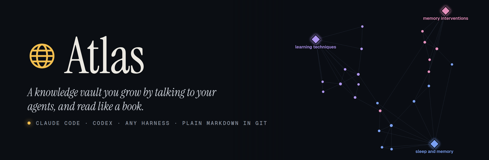
</p>
<p align="center">
  <a href="https://a-ratz.github.io/atlas/"></a>
  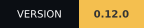
  
  
  
  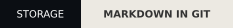
  
</p>

# 🗺️ Atlas

> **Grow a knowledge vault by talking to your agents. Read it like a book.**

Atlas is a local web app over a folder of plain Markdown. You ask a question in
its chat; your agent (Claude Code, Codex or any other harness) researches it,
lands a capture, distills it into insights and links them into maps, while you
read along in the browser. Projects get one shared memory that every agent
loads, and Atlas keeps the page honest: every claim shows how far to trust it
and where it came from. The files are the truth, git is the history, and there
is no database and no account.

**[▶ Try the live demo](https://a-ratz.github.io/atlas/)**: the demo vault in your browser, nothing
to install. No AI agent is connected there; the chat replays a recorded session, including one
distill you can start yourself.

**New in 0.5:**

- 🧭 **[Tours](#tours):** your agent walks you through what changed since your last visit and marks what needs your call.
- 🌙 **[Chart Room](#what-you-get):** a new look, dark and Paper light, built for long reading on desk and phone.
- 🧪 **[Demo vault](#demo-vault):** try a full vault the minute Atlas is installed; one sentence removes it again.

## Contents

- [Quick start](#quick-start)
- [What you get](#what-you-get): [Home](#home), [the reader](#the-reader), [talking to your agents](#talking-to-your-agents), [tours](#tours), [the constellation](#the-constellation), [projects](#projects-and-their-memory), [small things](#small-things)
- [How it works](#how-it-works)
- [Your agent's side](#your-agents-side)
- [Demo vault](#demo-vault)
- [How Atlas compares](#how-atlas-compares)
- [Status and roadmap](#status-and-roadmap)
- [This repository](#this-repository)

---

## Quick start

```bash
npx skills add a-ratz/atlas -g -s atlas
```

This installs one global skill, `atlas`, for every agent harness on the machine
([skills CLI](https://github.com/vercel-labs/skills)).

Then say **"start atlas"** in Claude Code, Codex or any other harness. The first
time, the skill asks where Atlas should live (default `~/atlas`), installs it
there and offers the [demo vault](#demo-vault). Open
**http://localhost:8765** and type what you are curious about, or `/` for
commands.

The engine needs [uv](https://docs.astral.sh/uv/), which brings Python and the
packages along; the agent installs it after asking if it is missing. Optional:
git for history and the feed, [QMD](https://github.com/tobi/qmd) for semantic
search, Tailscale for your phone.

<p align="center">
  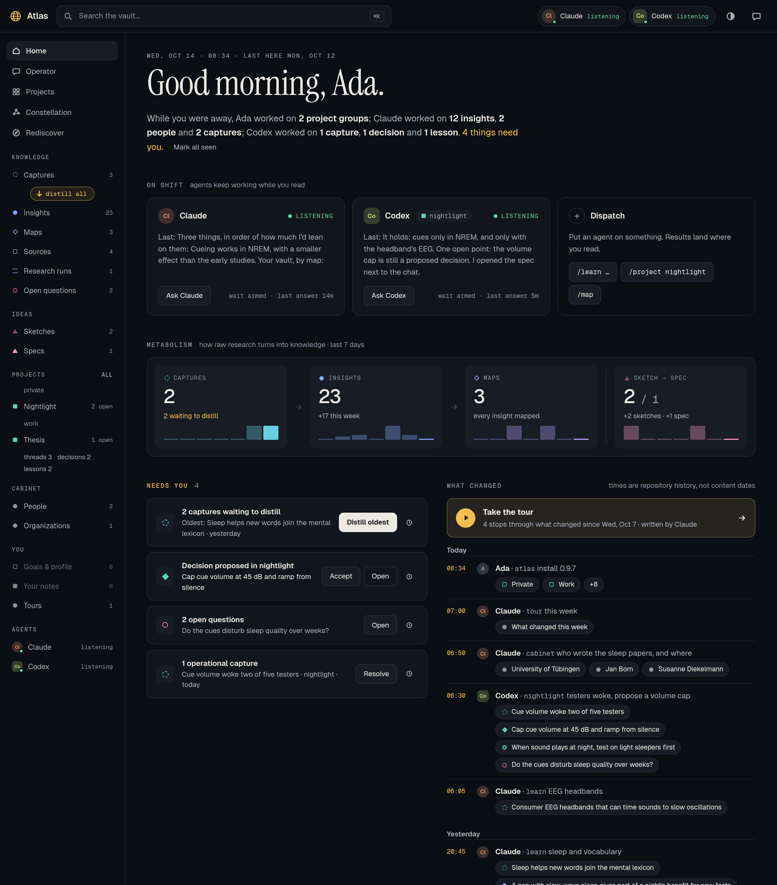
</p>
<p align="center"><i>Home with the demo vault: two agents listening, the week's metabolism, four things that need you, and a tour waiting.</i></p>

---

## What you get

### Home

What happened while you were away, in one paragraph read from git, then the
agents on shift with their state and last answer.

- **Metabolism:** captures → insights → maps, and sketches → specs, with
  seven-day sparklines of what arrived.
- **Needs you:** captures waiting to distill, proposed decisions, due revisits,
  open questions, your own notes. Snooze a row until tomorrow, next week or next
  month; it comes back early when what it counts changes.
- **What changed:** the git log with the agent behind each commit (`Atlas-Agent`
  trailer); three or more commits in a row by the same hand fold into one row.

### The reader

<p align="center">
  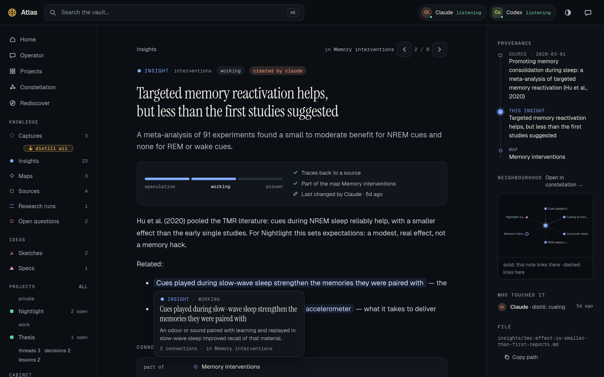
</p>

- **How far to trust it:** a meter over the note's status (speculative →
  working → proven), whether it traces to a source, which map holds it, who
  changed it last.
- **Provenance:** the chain from the source through the capture to this note.
- **Hover a link** to see where it goes; the map's previous and next note sit in
  the header; a small graph shows the neighbourhood.
- **Your move:** buttons that fit the kind of note (an insight: find
  connections, challenge it; a capture: distill it), plus keep, let go or leave a
  note. Select any passage to ask your agent about it or challenge it.

### Talking to your agents

<p align="center">
  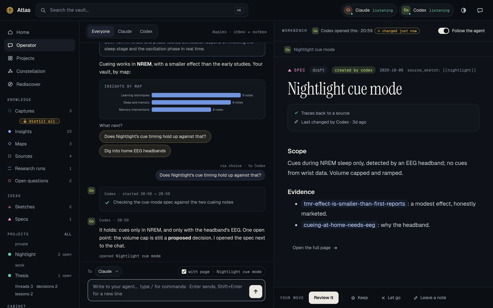
</p>

The chat is a panel next to your reading, and a full page with a workbench.
Agents answer with **blocks**: note cards you unfold in place, charts, choices,
checklists and sandboxed HTML mockups. Several agents can listen at once, each
under its own name; long jobs show their steps live. When an agent opens a page
for you, it lands in the workbench, next to the conversation.

### Tours

<p align="center">
  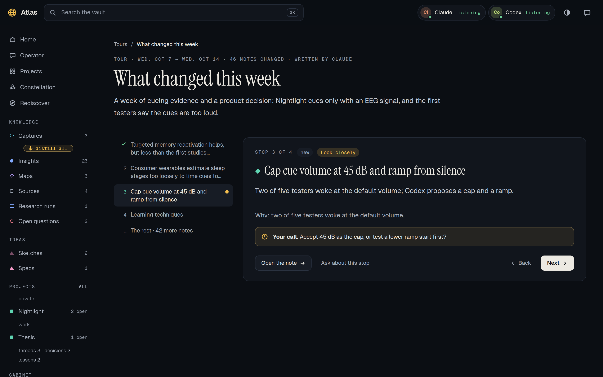
</p>

Ask for one with `/tour` or **Write a tour** on Home. Your agent picks the
stops that change what the vault claims or what you might decide, in reading
order, each with why it matters and the passage that carries it. **Look
closely** marks a call only you can make. Atlas holds the tour to the record:
a quoted passage must stand in its note, and every other note that changed in
the period is listed under "The rest", so a tour cannot hide one. Finishing a
tour marks its period as seen.

### The constellation

<p align="center">
  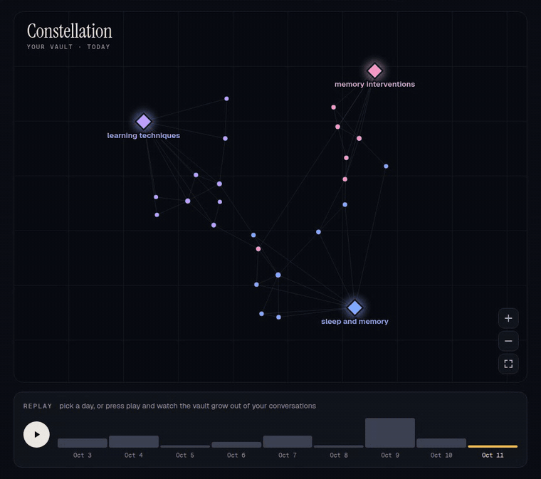
</p>

Every insight and map as a living graph, with maps as hubs. Colour it by map,
author or category, fly to a note, or press play and watch the vault grow out
of your conversations, day by day.

### Projects and their memory

<p align="center">
  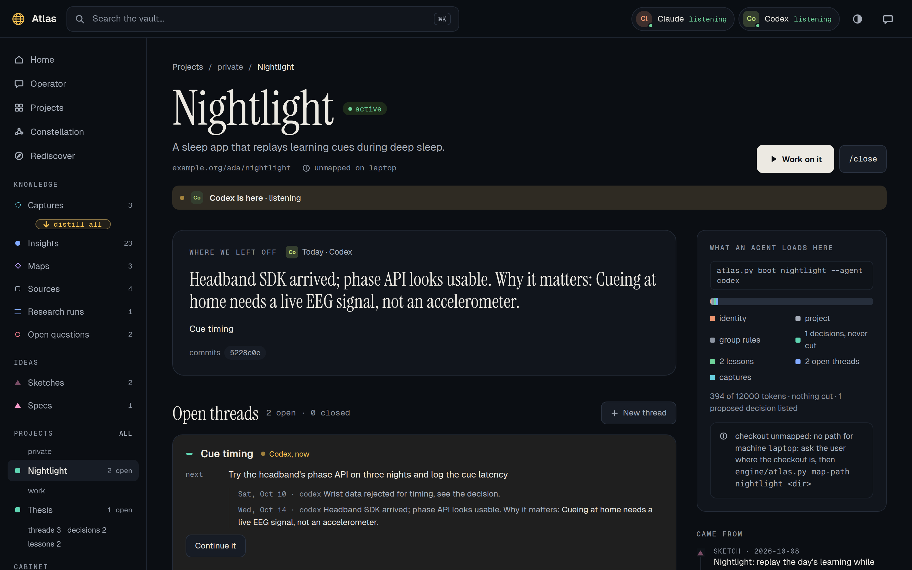
</p>

Projects live in groups (private, work, …) with group rules. Each project has
one memory that every agent shares: **threads** with their next step and a log,
**decisions** (proposed → accepted), **lessons** that hold beyond one session.
The page shows where you left off and exactly what an agent loads before it
starts (`atlas.py boot <project> --agent <id>`), with its token budget.

### People and organizations

<p align="center">
  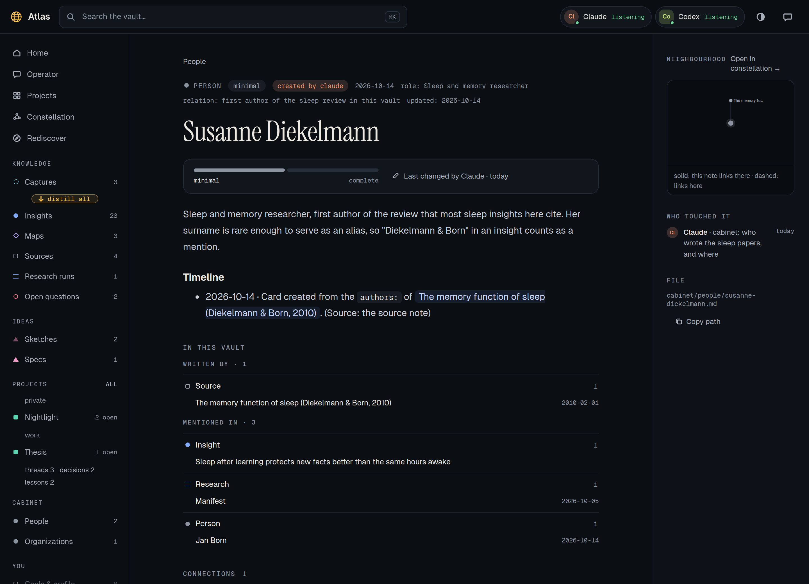
</p>

The Cabinet: `cabinet/people/` and `cabinet/orgs/` hold one card per person or organization:
role, relation, contact details, the current state, and a timeline that only
grows. When a chat message names someone, `wait` hands your agent their card.
A card's page lists the notes that mention them and the papers whose `authors:`
name them, so "which insights about Anthropic do we have?" or "which papers by
this author did we read?" is one click (or `atlas.py mentions "<name>"`).

Cards grow from your research: when your agent distills a capture, it writes a
minimal card for each person and organization the new insights rest on, with
only what the capture says. **Expand cards** (`/expand-cards`, or the button on
a card) completes them to a fixed profile (role, earlier roles, relevant works,
public channels for a person; what it does, size, website for an organization),
each fact with its source, within a budget of lookups per card that you set in
`atlas.yaml`. What it cannot find stays marked as not found.

Optional: with the first person card, your agent asks whether to fill new
cards from LinkedIn. On yes, it checks that it can drive your browser and that
you are logged in, then adds only professional details (role, employer, past
roles, education, public talks) with a dated source. It never connects,
messages, or touches your LinkedIn settings. The person sees the profile visit
unless you use LinkedIn's private mode.

### Small things

<p align="center">
  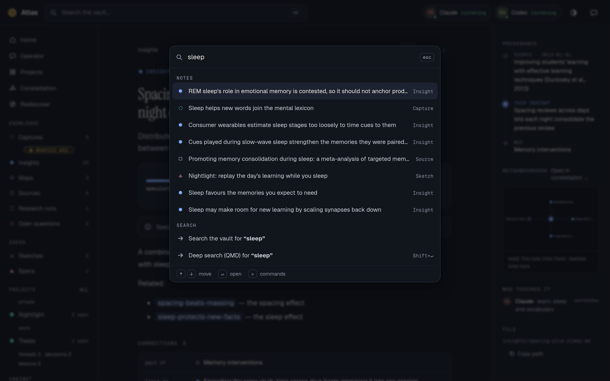
</p>

- **⌘K / Ctrl+K** jumps to any note, project or place; `>` lists the chat
  commands.
- **Undo:** keep, let go, notes and snoozes wait five seconds before they reach
  your agent.
- **Drop a file or a link** on Atlas: it lands in `captures/`, ready for your agent.
- **Search:** instant text match, or search by meaning through [QMD](https://github.com/tobi/qmd): the installer offers it, `engine/atlas.py qmd setup` indexes the cabinet, projects, ideas, insights and sources as five collections, and every commit keeps them fresh in the background.
- **Paper and Pocket:** a light theme for daylight, and a phone layout with a
  tab bar; `atlas.py expose` prints the Tailscale command to reach it on your
  tailnet.

<p align="center">
  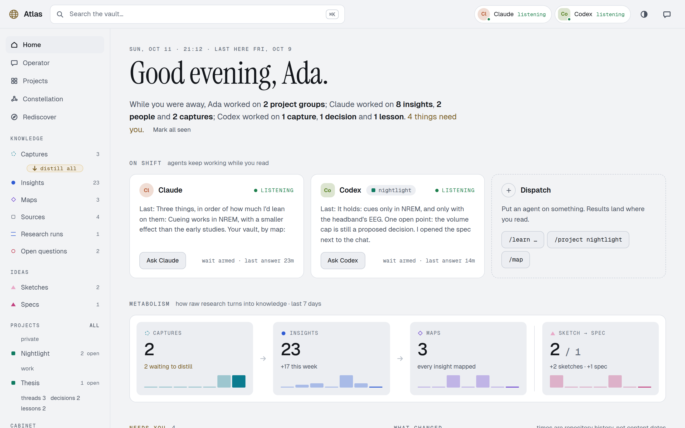
  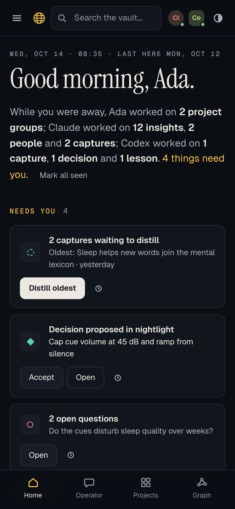
</p>

---

## How it works

```text
you ──── browser ──── Atlas  (engine/atlas.py on localhost:8765)
                        │  reads live          ▲ inbox.jsonl / outbox.jsonl
                        ▼                      │ (vault/.atlas/, disposable)
                     vault/  ◄──── writes ──── your agents: wait, work, say
              plain Markdown in your own git repository
```

- **Files are the truth.** Every note is a Markdown file with frontmatter. The
  index is rebuilt from the files; delete it and nothing is lost.
- **A registry, not code.** `vault/atlas.yaml` says which folder holds which kind
  of note, which fields to show, which buttons a page offers and which `/`
  commands exist. A new kind of note is a few lines of YAML.
- **Duplex through files.** Your agent runs `atlas.py wait`, which blocks until
  you write, and answers with `atlas.py say`. Any harness that can run a command
  can operate Atlas; no plugin API is involved.
- **Checks that protect a claim.** `atlas.py check` finds broken links,
  frontmatter that breaks the registry's rules and insights connected to nothing;
  `atlas.py next` turns the vault's state into suggestions.
- **Attribution.** `atlas.py commit --agent <id>` stamps `created_by` /
  `updated_by` and the commit trailer, so Atlas always knows which agent wrote
  what.

```text
vault/
  captures/   raw research, waiting to be distilled
  insights/   one claim per file; maps are insights/<topic>-map.md
  sources/    processed sources (provenance)
  research/   longer research runs
  questions/  open questions that would change a claim (at most 7 open)
  sketches/   specs/      ideas, rough and worked out
  projects/<group>/<project>/   project.md, threads/, decisions/, lessons/
  tours/      guided walks through what changed
  you/        your goals, profile and notes
  agents/     one identity file per agent
```

---

## Your agent's side

Atlas ships the workflows as skills that every harness reads from
`.agents/skills/` (Claude Code also finds them in `.claude/skills/`):

| When you… | Your agent follows |
|---|---|
| ask to start Atlas | `atlas-operator`: serve, listen, answer with blocks, write tours |
| ask a question or name a topic | `atlas-learn`: research it, land a capture with sources |
| agree to distill | `atlas-distill`: one claim per insight, every claim traced to its source |
| have a cluster of insights | `atlas-map`: group them into a map |
| say "I have an idea…", or ask for ideas | `atlas-sketch`: write it down, or generate candidates from the vault and keep the survivors |
| want a sketch worked out | `atlas-spec`: a spec grounded in your insights, with a first slice; then a project |
| want a card for someone, or ask to look them up | `atlas-cabinet`: create and update cards, optionally from LinkedIn |
| name a project, or close a session | `atlas-project`: load its memory, keep threads, decisions and lessons current |
| want the demo gone | `atlas-clean-demo` |

In the chat, `/` lists the commands (`/learn`, `/distill`, `/map`, `/sketch`, `/spec`,
`/project`, `/close`, `/remember`, `/check`, `/next`, `/tour`); add your own in
`vault/atlas.yaml`.

---

## Demo vault

The installer offers a demo: a researcher's vault on sleep, memory and learning,
with 23 insights in three maps, sources, a research run, open questions, a
sleep-app project and a thesis, a tour, and a git history over the last ten
days, written by Claude and Codex. The screenshots above show it; only the
chat and the name Ada were added for the pictures.

The [live demo](https://a-ratz.github.io/atlas/) is this vault, recorded:
`site/build.py` runs the real engine on it and records every answer, and the page
replays them without a server or an agent.

```bash
uv run --no-project engine/atlas.py demo            # load it (never over an existing note)
uv run --no-project engine/atlas.py demo --remove   # take it out again
```

Or tell your agent **"clean the demo"** (`atlas-clean-demo`). Removal deletes
every demo note you have not changed and keeps the ones you edited; git history
stays as it is.

---

## How Atlas compares

| | Notes app | Chat with memory | Atlas |
|---|---|---|---|
| **Who writes** | You | The assistant, inside the chat | Your agents, while you read along |
| **Where it lives** | Files you own | The provider's account | Markdown in your own git repository |
| **Provenance** | What you add by hand | Not tracked per claim | Every insight traces to its source; checks flag gaps |
| **Agents** | Plugins | One assistant | Any harness, several at once, by name |
| **Reading** | Your own structure | You have to ask | Maps, tours, a trust meter on every page |

**Atlas fits when** you research with agents and want the results to add up to
something you can read, trust and come back to, across projects and harnesses.

**Look elsewhere when** you need a team wiki with permissions, real-time
collaborative editing, or a tool without an agent in the loop. Atlas is
single-user, local-first and young.

---

## Status and roadmap

Atlas 0.9.2 is the current release. Stable: the
engine and reader, the duplex chat with answer blocks, project memory with boot
packets, the checks, tours, the installer with upgrade and restore.

Open:

- Listening in the foreground (Codex, pi) is not yet verified end to end.
- One vault per server; "since you were last here" is kept per browser.
- Not built yet, by decision: packs (heavier knowledge-graph machinery as an
  opt-in), hard enforcement of group rules, `atlas-spec` and `atlas-revisit`
  workflows.

---

## This repository

```text
skills/atlas/SKILL.md            the global skill: installer, pointer, factory copy
skills/atlas/scripts/            atlas_install.py: status, install, locate, upgrade, restore
skills/atlas/references/         onboarding for the first run
skills/atlas/app/                the app that gets installed: engine/, vault/, demo/, AGENTS.md, .agents/skills/
docs/assets/                     images and badges for this README
site/                            the live demo: build.py records the engine on the demo vault, demo.js replays it
```

- Update: `npx skills update atlas`, then "update atlas" (upgrades the app files
  you have not changed; your vault is never touched).
- Reset a workflow you edited: "restore the learn skill" (or `skills`, `engine`,
  `all`); the old version goes to `.atlas-backup/`.
- Try a change locally: `npx skills add /path/to/this/repo -g -s atlas`, then
  "update atlas" in your harness. Run the engine straight from the repo:
  `uv run --no-project skills/atlas/app/engine/atlas.py serve --vault <some vault>`.

## License

MIT, see [LICENSE](LICENSE).
